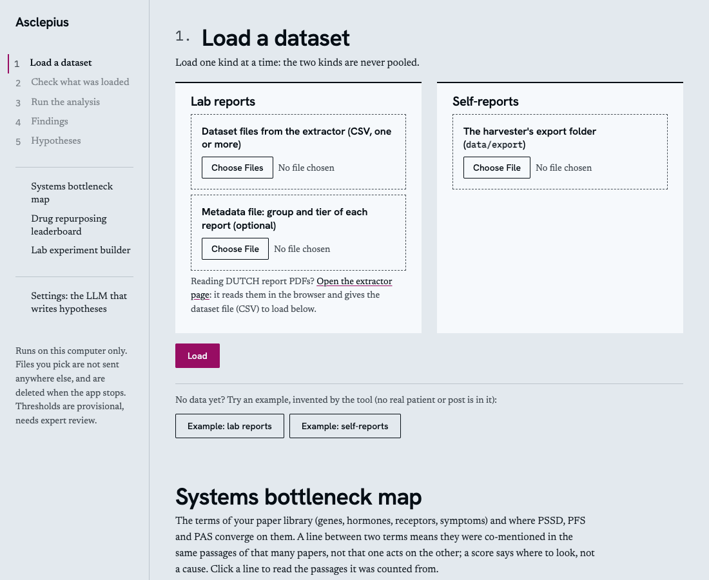
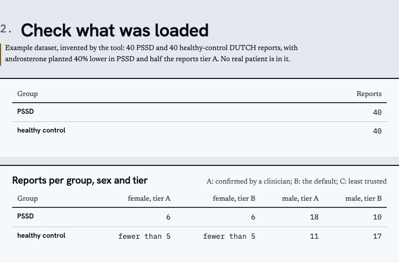
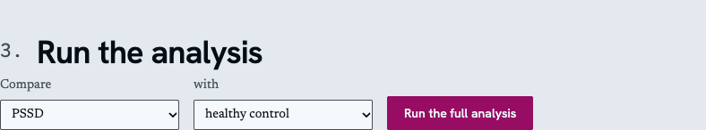
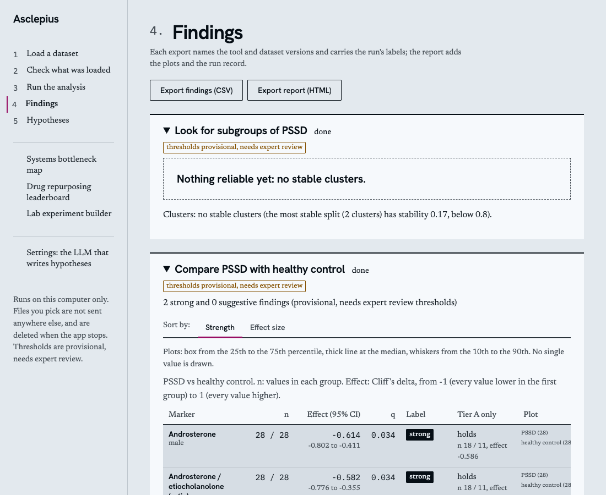
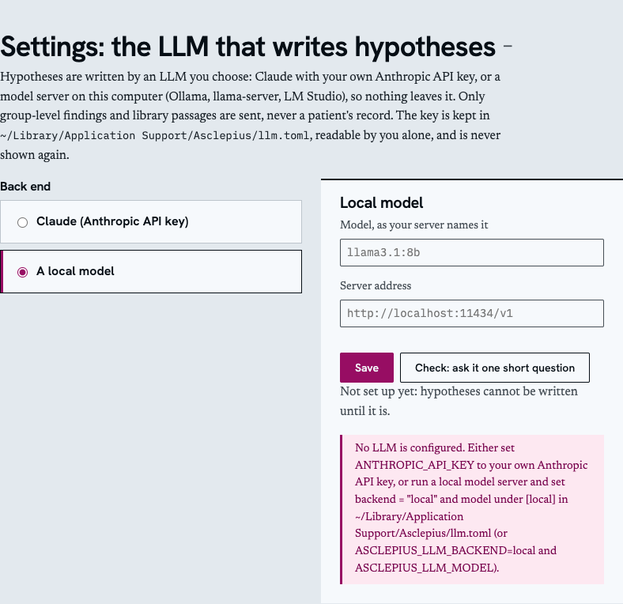
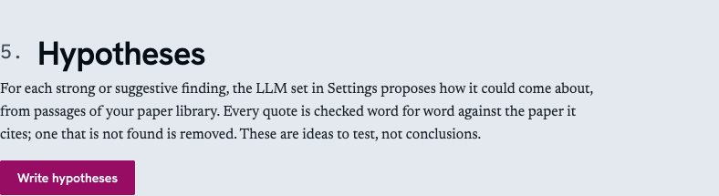
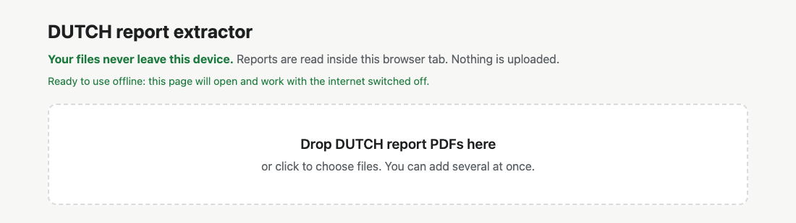

# Asclepius: install and usage guide

This guide is for clinicians and researchers. It assumes no programming. You will type a few
commands into a terminal once, and after that everything happens in your web browser.

Asclepius is a research tool for post-SSRI sexual dysfunction (PSSD) and related post-drug
syndromes. It finds patterns in groups of patients' data and proposes testable hypotheses, each
backed by quotes from published papers. **It does not diagnose and does not give treatment
advice.** Every threshold it uses is provisional and needs expert review.

Everything runs on your own computer. Files you load into it are not uploaded anywhere.

**Contents:** [What you need](#what-you-need) · [Install](#install) ·
[Try the example](#try-the-example) · [Hypotheses](#hypotheses) ·
[Your own data](#your-own-data) · [Day to day](#day-to-day) · [Problems](#problems)

## What you need

- A Mac, Windows or Linux computer, with about 2 GB of free disk space
- An internet connection for the first setup (an hour or more, mostly waiting)
- For hypotheses only, one of these:
  - an Anthropic API key, from [console.anthropic.com](https://console.anthropic.com) (you pay
    Anthropic for what you use; nobody else sees the key), or
  - a language model running on your own computer, such as [Ollama](https://ollama.com), so
    nothing leaves your computer at all

You do not need an API key to install the tool, run the example or see the statistical findings.

## Install

### 1. Open a terminal

- **Mac:** press Cmd+Space, type `Terminal`, press Enter.
- **Windows:** press the Windows key, type `PowerShell`, press Enter.
- **Linux:** open your terminal application.

Type or paste each command below into it and press Enter. Wait for one command to finish (the
prompt comes back) before typing the next.

### 2. Install uv

uv is a free installer for Python programs. It fetches the right Python by itself, so you do not
need to install Python.

Mac or Linux:

```sh
curl -LsSf https://astral.sh/uv/install.sh | sh
```

Windows (PowerShell):

```powershell
powershell -ExecutionPolicy ByPass -c "irm https://astral.sh/uv/install.ps1 | iex"
```

**Then close the terminal and open a new one**, so it finds `uv`.

### 3. Install Asclepius

```sh
uv tool install --python 3.14 https://github.com/jaafarmohammad98/asclepius/releases/download/v0.1.0/asclepius-0.1.0-py3-none-any.whl
```

If you were sent the file `asclepius-0.1.0-py3-none-any.whl` instead, put the path to that file
in place of the web address. On a Mac or in Windows PowerShell you can type
`uv tool install --python 3.14 ` (with the space at the end), drag the file onto the terminal
window so its path appears, and press Enter.

If it ends with a warning that a folder "is not on your PATH", run `uv tool update-shell`, then
close the terminal and open a new one.

### 4. Build the paper library

Hypotheses may only quote papers in your own library, which is built from PubMed and open-access
full text. Run these two commands, one after the other:

```sh
asclepius-library build
asclepius-library index
```

Together they take an hour or more the first time; you can leave them running. `build` downloads
the paper records and their open-access text, and ends with a line such as
`full text for 732 of 3784 papers (19%)`. `index` makes those papers searchable (it downloads a
64 MB search model once). Neither command sends
anything about you. If `build` stops partway (a lost connection, say) and says
`asclepius-library fulltext` continues, run that command: what was downloaded is kept. Otherwise,
or if `index` stops, run the same command again.

You can skip this step if you only want the statistical findings. You need it for hypotheses.

### 5. Start the app

```sh
asclepius
```

Your web browser opens the app. Leave the terminal window open while you use it. To stop the app,
click in the terminal and press Ctrl+C. Next time, open a terminal and type `asclepius` again.
Steps 1 to 4 are needed only once.



## Try the example

The app has two built-in example datasets. Both are invented by the tool: no real patient or
post is in either. They let you try every step before you have any real data.

**1. Load.** Click **Example: lab reports**. This loads 80 invented DUTCH hormone reports, 40
labelled PSSD and 40 healthy controls. A difference was planted on purpose (androsterone 40% lower
in the PSSD group), so you can check that the tool finds it.

**2. Check what was loaded.** The app shows how many reports are in each group, by sex and
confidence tier. A count under 5 is shown as "fewer than 5", never as a number.



The tiers say how far each record is trusted: **A** confirmed by a clinician, **B** the default,
**C** least trusted.

**3. Run.** Choose the two groups to compare (here, PSSD with healthy control) and click
**Run the full analysis**. A progress bar shows each step; on the example it takes a minute or
two.



**4. Read the findings.** Each part of the analysis gets its own section.



How to read a row:

| Column | Meaning |
|---|---|
| **n** | how many values each group had |
| **Effect (95% CI)** | Cliff's delta, from −1 (every value lower in the first group) to 1 (every value higher), with its 95% confidence interval |
| **q** | the p-value corrected for the number of tests run (false discovery rate) |
| **Label** | **strong**, **suggestive** or **noise-level**, from q, effect size and sample size |
| **Tier A only** | whether the finding still holds using only clinician-confirmed records |
| **Plot** | box from the 25th to the 75th percentile, median as a thick line, whiskers at the 10th and 90th. No single patient's value is drawn |

In the example, androsterone and the androsterone/etiocholanolone ratio come out **strong** in
men, which is the planted difference. "Nothing reliable yet" is a normal result: it means the data
do not support a claim, and the tool says so rather than showing a weak pattern.

**Export.** **Export findings (CSV)** gives a spreadsheet; **Export report (HTML)** gives a page
with the plots and a record of exactly what was run (tool version, dataset fingerprint, settings),
so the result can be reproduced.

The second example, **Example: self-reports**, works the same way with invented forum-style
self-reports. Its findings are never labelled strong and carry the label "self-report, no
controls".

## Hypotheses

### Set up the language model

Open **Settings: the LLM that writes hypotheses**, last in the contents on the left. Until it is set up it
shows a red "No LLM is configured" message; that is expected.



- **With an Anthropic API key:** choose **Claude (Anthropic API key)**, paste your key into
  **API key**, and click **Save**. The model box can stay as it is.
- **With a model on your own computer:** start your model server (for Ollama, install it and run
  `ollama pull llama3.1:8b`), choose **A local model**, type the model's name and click **Save**.
  Small local models write weaker hypotheses than Claude.

Click **Check: ask it one short question** to test it. The key is stored in a file only your user
account can read, and the page never shows it again.

Only group-level findings and passages from your paper library are sent to the model, never a
patient's record. The app checks every outgoing request for this before sending it.

### Write them

After a run, scroll to **5. Hypotheses** and click **Write hypotheses**.



For each strong or suggestive finding the model proposes how it could come about, using passages
from your library. With Claude this takes a few minutes and costs a little on your Anthropic
account. Every hypothesis has the same five parts:

1. The finding in the data, with its strength label
2. The proposed mechanism
3. Supporting papers
4. Contradicting papers
5. How to test it

Every quote is checked word for word against the paper it cites, and a quote that is not found is
removed. Each source links to the paper. Where a hypothesis names a drug, supplement or other
intervention, it is marked as a candidate for study and its known risks are listed: these are ideas
to test, not recommendations. **Export hypotheses (HTML)** saves them with the record of the run.

## Your own data

### DUTCH reports (PDF)

The app links to the **extractor page** ("Open the extractor page", under **Lab reports**). Drop DUTCH report
PDFs onto it. It reads them inside the browser tab; the PDFs are never uploaded, and the page works
with the internet switched off.



It keeps sex, age in years, the month of collection, the month of the report and every result row. It never keeps name,
date of birth, address, accession number, ordering physician or exact dates. Check each report's
warnings, remove any duplicates, and download the batch as **CSV**.

It reads the classic DUTCH Complete layout (reports from about 2018 to 2021). It has been tested
only on three public sample reports, and **its accuracy on real patient reports has not been
measured yet**, so check its values against the PDF. It cannot read the 2025 layout or scanned
or photographed reports; DUTCH Plus and Cycle Mapping are untested.

### Load it

Under **Lab reports**, choose the CSV file(s) from the extractor. To compare groups you also need
a **metadata file**: a CSV with one row per report, which you write in a spreadsheet and save as
CSV.

| Column | Required | What to put |
|---|---|---|
| `record_id` | yes | the report's id from the extractor CSV: `r001`, `r002`… Only when you load several extractor files that each have an `r001` do you add the file's number: `2/r001` is `r001` of the second file |
| `group` | yes | PSSD, PFS, PAS, SSRI-exposed control or healthy control; blank means not assigned |
| `tier` | no | A (confirmed by a clinician), B or C; blank means B |
| `drug` | no | the drug taken, as free text |
| `months_since_stopping` | no | a number |
| `score_<name>` | no | a symptom score, for example `score_libido` |

Example:

```csv
record_id,group,tier,drug
r001,PSSD,A,sertraline
r002,healthy control,B,
```

Then click **Load**. If something in a file is wrong, the app names the file, line and column.

The **Self-reports** box takes the export folder of the r/PSSD harvester, which is handed to
researchers directly. The two kinds of data are never mixed in one analysis.

When you stop the app, the files you loaded are deleted from its working folder. Your originals
are not touched.

## Day to day

**Your own papers.** Make a folder named `private` inside the data folder (below), put PDFs you
have in it (preprints, unpublished results), and run `asclepius-library refresh`, then
`asclepius-library index`. They are read on your computer and never looked up online. They join
your library's search (`asclepius-library search "your question"`), but their text is never sent
to a language model, so hypotheses do not quote them.

**Monthly refresh.** To add new papers from PubMed, run `asclepius-library refresh`, then
`asclepius-library index`. Only new papers are downloaded.

**The data folder** holds the library, its index, the search model and the LLM settings:

- Mac: `~/Library/Application Support/Asclepius` (in Finder, choose Go > Go to Folder… and paste
  this)
- Windows: `%LOCALAPPDATA%\Asclepius`
- Linux: `~/.local/share/asclepius`

**Remove** the tool with `uv tool uninstall asclepius`. **Update** to a new version by removing it
and then running step 3 with the new version's address or file. Neither touches the data folder,
so your library and settings stay; delete that folder by hand if you want them gone too.

## Problems

| What you see | What to do |
|---|---|
| `command not found: uv` (or "not recognized") | Close the terminal and open a new one. If it persists, repeat step 2. |
| `command not found: asclepius` | Run `uv tool update-shell`, then open a new terminal. |
| `Cannot listen on port 8765` | The app is probably already running in another terminal window: use that one, or start this one with `asclepius --port 8766`. |
| The browser does not open | Open `http://127.0.0.1:8765/` yourself. |
| `build` stops with a network error | Run `asclepius-library fulltext`; it continues where `build` stopped. If `build` stopped before it printed that command, run `build` again. |
| Hypotheses say the library or index is missing | Run step 4. |
| Hypotheses fail with an error from the model | Open Settings and click **Check**: it shows what the model answered. A wrong or expired key, or a local model server that is not running, are the usual causes. |

Anything else, or a report the extractor reads wrongly: open an issue at
[github.com/jaafarmohammad98/asclepius/issues](https://github.com/jaafarmohammad98/asclepius/issues).
Never attach a patient's report or data to an issue.

## Licence

Asclepius is free software under the AGPL-3.0-or-later licence.
